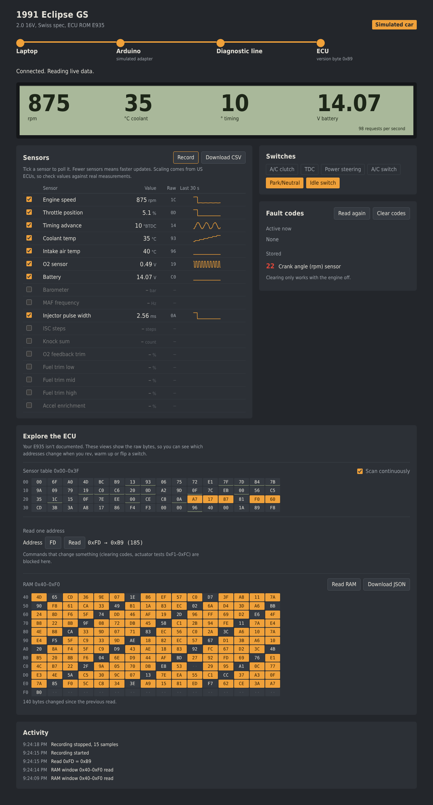

# dsm-diag

Open-source diagnostics and datalogging for **1G DSMs**: the 1990–94 Mitsubishi
Eclipse, Eagle Talon and Plymouth Laser. It reads live sensor data and fault codes
from the stock ECU over the 12-pin diagnostic connector, using parts from an
Arduino starter kit. No ECMLink, no ECU modifications.



> **Status:** early. The adapter and software work on the bench; the first
> in-car tests are on a 1991 Swiss-spec Eclipse GS with the European E935 ECU.
> Sensor scaling comes from US ECUs and may differ on yours.

## What it does

- **Dashboard** in the browser: live readings, all known sensors with trends,
  switch states, fault codes (read and clear), CSV recording
- **Connects by itself** when you plug in the adapter, and tells you which step
  fails if something isn't wired right
- **Explore the ECU**: live view of the sensor table 0x00–0x3F, single-address
  reads and RAM dumps with changed bytes highlighted, for undocumented ECUs like the E935
- **Read-only by design**: actuator tests and other commands that change something
  are blocked; only "Clear codes" writes, and only when you click it
- **Simulation mode** to try everything without a car

## Quick start

You need Node.js 20+ and an Arduino Uno (or clone).

```
git clone https://github.com/<you>/dsm-diag
cd dsm-diag
npm install
npm run sim          # try it with a simulated car: http://localhost:1991
```

With real hardware:

1. Build the adapter: [docs/wiring.md](docs/wiring.md)
2. Upload `firmware/dsm_bridge/dsm_bridge.ino` with the Arduino IDE
   (set `WIRING_12V` or `WIRING_5V` to match your line voltage)
3. `npm run dashboard` and open http://localhost:1991
4. Plug in the Arduino, connect it to the car, ignition on

A terminal tester is also included: `npm run cli -- /dev/ttyUSB0`.

## Repository layout

| Path | What |
|---|---|
| `src/mmcd.ts` | Protocol, sensor table, fault code decoding |
| `src/nodeserial.ts`, `src/webserial.ts` | Serial transports (Node, Chrome Web Serial) |
| `src/server/` | Dashboard server: adapter discovery, request queue, simulation |
| `web/` | Dashboard page |
| `src/cli.ts` | Terminal tester |
| `firmware/dsm_bridge/` | Arduino bridge (bit-banged 1953 baud, 5 V or 12 V wiring) |
| `firmware/voltcheck/` | Measures the diagnostic line voltage |
| `docs/` | Wiring, protocol, E935 notes |
| `hardware/` | Roadmap for a standalone USB cable |
| `test/` | Bridge firmware simulation against a virtual ECU |

## Safety

- The software only reads, apart from "Clear codes". The ECU's program and maps live
  on an EPROM that cannot be written over the diagnostic port.
- On undocumented ECUs, an address could mean something different than on US ECUs.
  Explore with the **engine off**; the worst case is a component test running for a few seconds.
- Wiring mistakes mostly endanger the Arduino, not the car. Follow
  [docs/wiring.md](docs/wiring.md) and keep the driver module's "+" unconnected.
- Don't watch the dashboard while driving. Record to CSV and look afterwards.

## Contributing

Owners of other 1G cars and ECU versions are especially welcome. Useful contributions:

- Version byte (`0xFD`) and verified addresses for your ECU, added to
  [docs/e935.md](docs/e935.md) or a new page for your ROM ID
- EPROM dumps and disassembly notes
- Hardware: the [standalone cable](hardware/README.md)

Run `npm test` before opening a pull request.

## Credits

This project stands on years of DSM community work: the MMCd project, the
commented E931/E932 disassembly, the ECMTuning wiki, DSMTuners threads, and
[illja96/mmcdlogger](https://github.com/illja96/mmcdlogger) and
[kevin-buckham/MMCd-Go](https://github.com/kevin-buckham/MMCd-Go).
See [docs/protocol.md](docs/protocol.md) for sources.

Not affiliated with Mitsubishi, ECMTuning or DSM Cables.

## License

MIT
