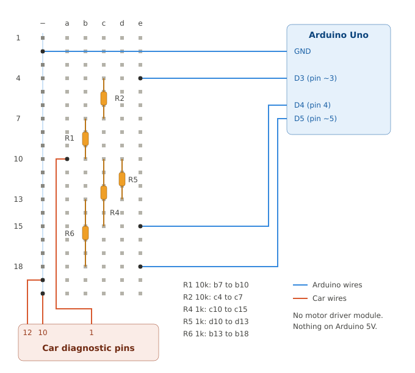
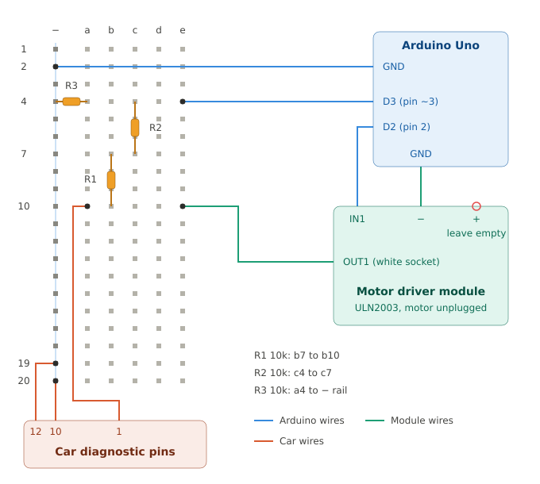

# Wiring

Everything here uses parts from a typical Arduino Uno starter kit.

## The diagnostic connector

12-pin connector next to the fuse box, driver's footwell. Seen from the front
(pins pointing at you), the 1G layout is two rows of six. On cars where the
connector is mounted on its side, the rows run vertically:

```
 1  2  3  4  5  6        or, mounted sideways:   [1 ]   [7 ]
 7  8  9 10 11 12                                [2 ]   [8 ]
                                                 [3 ]   [9 ]
                                                 [4 ]   [10]
                                                 [5 ]   [11]
                                                 [6 ]   [12]
```

| Pin | Function | Notes |
|---|---|---|
| 1 | ECU data | Bidirectional. Without the pin 10 bridge, it carries flash-code pulses. |
| 5 | Cruise control data | Not used |
| 6 | Automatic transmission data | Not used |
| 10 | Diagnostic mode | Bridge to pin 12 to enable |
| 11 | Vehicle speed sensor | Reed switch to ground; can look like a second ground when parked |
| 12 | Ground | |

Confirm before wiring: pin 12 has continuity to chassis, pin 1 does not.

## Step 1: measure the line in diagnostic mode

1. Turn the key off and bridge pin 10 to pin 12.
2. Turn the key on. The engine stays off.
3. Measure pin 1 against pin 12 in volts.
4. If it reads 0 V, measure again in ohms. Keep the key on.

| Result | Line type | Wiring |
|---|---|---|
| About 12 V | The ECU holds the line high. | [12 V wiring](#12-v-wiring-with-the-uln2003-motor-driver-module) |
| About 5 V | The ECU holds the line high at 5 V. | [5 V wiring](#5-v-wiring-only-if-the-line-measures-5-v) |
| 0 V, megaohms to pin 12 | The line floats. The ECU drives it high to talk: an inverted line. Measured on the E935. | [Inverted wiring](#inverted-wiring-e935) |
| 0 V, below 1 kΩ to pin 12 | The ECU holds the line low. | None fits. Check the pin, and report it. |

Do not choose the wiring from a reading without the bridge. Then the ECU sends
flash-code pulses, and a meter shows anything between 0 and 12 V.

## Inverted wiring (E935)

For an ECU that leaves pin 1 floating in diagnostic mode and drives it to 12 V
to reply. [e935.md](e935.md) has the measurements. Only resistors touch the line.



| From | To |
|---|---|
| R1 10k | b7 to b10 |
| R2 10k | c4 to c7 |
| R4 1k | c10 to c15 |
| R5 1k | d10 to d13 |
| R6 1k | b13 to b18 |
| Arduino pin 3 (D3) | e4 |
| Arduino pin 4 (D4) | e15 |
| Arduino pin 5 (D5) | e18 |
| Arduino GND | − rail |
| Car pin 1 | a10 |
| Car pin 12 | − rail |
| Car pin 10 | bridged to pin 12 |

Any free hole in the same row works, because each row is connected.

```
Arduino D4 ──[R4 1k]──┐
                      │
car pin 1 ────────────┼──[R1 10k]──[R2 10k]── Arduino D3
                      │
                      └──[R5 1k]──[R6 1k]──── Arduino D5
```

How it works:

- D5 pulls the line low through 2k while idle and listening.
- To send, D5 lets go, and D4 drives the line to 0 V or 5 V through 1k.
- The ECU replies by driving the line to 12 V against the 2k.
- D3 reads the line through 20k.

Limits:

| Situation | Current | |
|---|---|---|
| The ECU replies (D5 low) | 6 mA from the ECU | Normal operation |
| The ECU drives while D4 is low | 12 mA | Only after a misread |
| Worst case, all paths at once | 18 mA | The ceiling: only resistors touch the line |
| Our voltage on pin 1 | 0 to 5 V | Never above what the ECU itself puts there |

Rules:

- **Do not connect the ULN2003 module to the line.** On an inverted line, it can
  short the ECU output to ground.
- **Keep the pin 10 bridge in place while the adapter runs.**
- **Connect in this order:** key off, bridge, connect the adapter, key on, start the software.
- **Disconnect in this order:** stop the software, key off, unplug.
- Run the laptop on its battery, not on a mains charger, to avoid a ground loop through the car.

For a permanent version, solder the same circuit on a stripboard with a Nano:
[hardware/nano-adapter.md](../hardware/nano-adapter.md).

In `firmware/dsm_bridge/dsm_bridge.ino`, set `#define WIRING_INVERTED` and upload.
Then start the dashboard with `npm run dashboard:e935`.

The firmware sends only the addresses verified on the E935, and the dashboard
offers only those. If the ECU drives the line while the Arduino sends, the ECU
misread the request. The firmware then lets go of the line and sends nothing more
until you unplug and replug the Arduino.

### Bench test without the car

1. Disconnect the three car pins. Keep everything else.
2. Run `npm run cli -- /dev/ttyUSB0 --e935`. The expected result is
   `no reply for 0x14`: the echo worked, only the ECU is missing.

| Message | Meaning |
|---|---|
| `no echo` | Sketch not uploaded with `WIRING_INVERTED`, wrong port, or D3 not connected. After a misread, the bridge is locked: replug it. |
| `echo mismatch … got 0x00` | The line is held high: the pin 10 bridge is missing, so the ECU sends flash codes. |
| `echo mismatch … got 0xFF` | The line never goes high. With the car connected: ignition off, because an ECU without power holds the line low. Otherwise check D4 and R4. |
| `echo mismatch`, all bits flipped | The ECU misread a request. The bridge stopped. |
| `no reply` | Wiring works; ECU not answering (ignition, pin 10 bridge) |

## 12 V wiring with the ULN2003 motor driver module

For a line that idles at about 12 V by itself.



| From | To |
|---|---|
| R1 10k | b7 to b10 |
| R2 10k | c4 to c7 |
| R3 10k | a4 to − rail |
| Arduino GND | − rail |
| Arduino pin 3 (D3) | e4 |
| Arduino pin 2 (D2) | module IN1 |
| Module − | Arduino GND (any GND pin) |
| Module OUT1 (top pin of the white socket, next to LED A) | e10 |
| Module + | **nothing** |
| Car pin 1 | a10 |
| Car pin 12 | − rail |
| Car pin 10 | bridged to pin 12 |

- **Module "+" must stay empty**, and the jumper cap next to it should be removed.
  The chip has diodes from every output to "+"; if "+" were powered, the car's 12 V
  would flow into the Arduino.
- **Find OUT1 with a continuity test** from the chip's top-right leg (pin 16,
  notch facing up) to the pins in the white socket.
- A single NPN transistor (PN2222, 2N3904, BC547, S8050) works instead of the module:
  D2 → 1k → base, emitter → GND, collector → 100–220 Ω → line.

In `firmware/dsm_bridge/dsm_bridge.ino`, set `#define WIRING_12V` and upload.

### Bench test without the car

1. Add a 1k resistor from c10 to the + rail and a wire from the + rail to Arduino 5V.
2. Move the D3 wire from e4 to d10.
3. Run `npm run cli -- /dev/ttyUSB0`. The expected result is `no reply for 0xFD`:
   the echo worked, only the ECU is missing.
4. **Undo steps 1 and 2 before connecting the car.**

| Message | Meaning |
|---|---|
| `no echo` | Sketch not uploaded, wrong port, or D3 not connected |
| `echo mismatch … got 0x00` | Line stuck low: missing pull-up (bench) or ignition off (car) |
| `echo mismatch … got 0xFF` | Line never pulled low: check D2 → IN1 and OUT1 → e10 |
| `no reply` | Wiring works; ECU not answering (ignition, pin 10 bridge) |

## 5 V wiring (only if the line measures ~5 V)

```
car pin 1 ──[330 Ω]── D2
car pin 10 ── car pin 12 ── Arduino GND
```

Keep `#define WIRING_5V`. D2 is used open-drain: it pulls the line low and
otherwise lets go, so the Arduino and ECU never fight.

Use this wiring only if pin 1 never carries 12 V. Flash-code pulses of 12 V
would push about 20 mA into D2.

## Linux notes

- The Uno clone shows up as `/dev/ttyUSB0` (CH340).
- If the port appears and vanishes, remove `brltty`: `sudo apt remove brltty`.
- If it vanishes together with other devices, the USB hub or dock dropped out.
  Plug the Arduino straight into the laptop.
- Add yourself to `dialout` for permission: `sudo usermod -aG dialout $USER`, then log in again.
