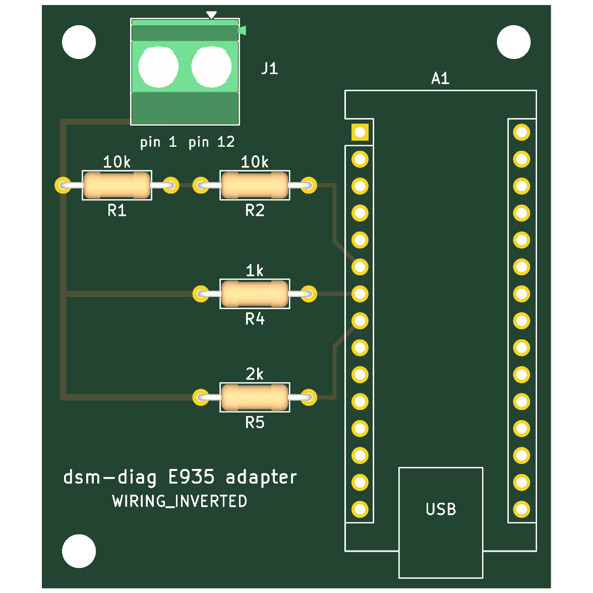

# Nano adapter PCB

A two-layer board for the [Nano adapter](../nano-adapter.md): 48 × 55 mm, through-hole parts only.

The scripts generate `dsm-adapter.kicad_sch` and `dsm-adapter.kicad_pcb`. Do not edit
the two files in KiCad: the next build overwrites them. Change the scripts instead.

| File | Owns |
|---|---|
| `generate_sch.py` | Parts, values and connections |
| `generate_pcb.py` | Placement, tracks, the ground pour and the silkscreen. It takes the nets from the schematic. |
| `build.sh` | Generates both files, runs ERC and DRC, and writes `out/` |

## Build

Run `hardware/kicad/build.sh`. It needs KiCad 10 with `kicad-cli` and the `pcbnew` Python module.

The script stops on any ERC or DRC violation and on any difference between the schematic and the board.

| Output | Use |
|---|---|
| `out/dsm-adapter-gerbers.zip` | Upload to the board maker |
| `out/dsm-adapter-schematic.pdf` | Schematic to print |
| `dsm-adapter-top.png`, `out/dsm-adapter-bottom.png` | 3D renders |

## Order

Upload the zip to JLCPCB, PCBWay or Aisler. The defaults fit:

- 2 layers, 1.6 mm FR-4, 1 oz copper
- HASL or ENIG finish
- Any solder mask colour

## Parts

| Ref | Part |
|---|---|
| A1 | Arduino Nano or clone, ATmega328P at 16 MHz. Use two 15-pin female headers, 2.54 mm, so the Nano stays removable. |
| R1, R2 | 10k, 1/4 W, 0207 body |
| R4 | 1k, 1/4 W, 0207 body |
| R5 | 2k, 1/4 W, 0207 body |
| J1 | 2-pin screw terminal, 5.0 mm pitch (Phoenix MKDS 1,5/2 footprint) |
| H1–H3 | M3 holes for a housing |

J1 takes the cable to the 12-pin plug. The silkscreen marks the car pins: pin 1 on the left, pin 12 on the right.

## Status

DRC and ERC pass. Nobody has ordered or tested this board yet.
Before you order, compare the Nano pinout of your clone with the footprint: D3, D4 and D5 are pads 6, 7 and 8.
