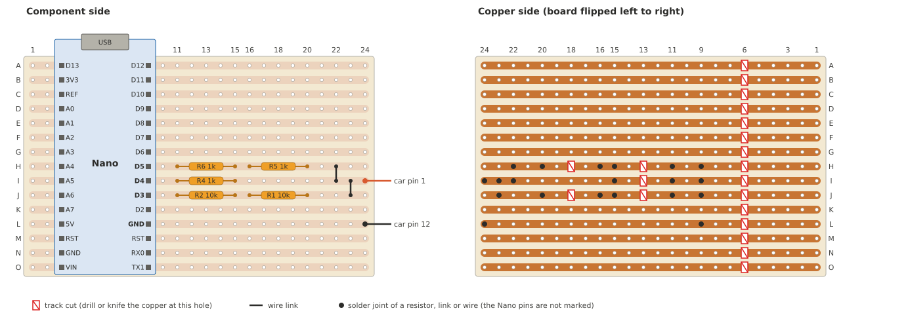

# Nano adapter (E935)

A soldered version of the [inverted wiring](../docs/wiring.md#inverted-wiring-e935).
It uses the same circuit and the same firmware. The Arduino Nano replaces the Uno,
and a stripboard replaces the breadboard.

The bridge firmware keeps the E935 allowlist and the misread lock. A plain
USB-serial cable has neither, so the E935 needs this microcontroller adapter.

`nano-adapter.py` draws the SVG. Before it draws, it checks the layout against
the circuit. Run `python3 hardware/nano-adapter.py > hardware/nano-adapter.svg`
after every change.

## Parts

| Part | Note |
|---|---|
| Arduino Nano or clone, ATmega328P, 16 MHz | With pin headers |
| Stripboard, 24 holes × 15 strips, 0.1" pitch | About 63 × 40 mm |
| R1, R2: 10k | 1/4 W, laid flat. They sit on adjacent strips, so use bodies under 2.5 mm. |
| R4, R5, R6: 1k | The same |
| Two short wire links | Solid core |
| Two-core cable | To the 12-pin plug |
| 12-pin mating plug | See [the roadmap](README.md#open-questions) |

## Build

1. Cut the copper at every red mark in the copper-side view. Use a 3–4 mm drill bit by hand.
2. Check every cut with a continuity meter. No strip may conduct across a cut.
3. Find the Nano header with D2–D12. Its holes go in column 9.
4. Compare the Nano labels with the drawing. D5, D4, D3 and GND must be on strips H, I, J and L.
5. Solder the Nano.
6. Solder the resistors, the links and the two car wires.
7. Wire the plug: the pin 1 wire to pin 1, the pin 12 wire to pin 12.
8. Bridge pin 10 to pin 12 inside the plug.
9. Fix the cable to the board with a cable tie through free holes.

## Check before the car

Keep the Nano unpowered and the plug free. Measure in ohms:

| From | To | Expected |
|---|---|---|
| Plug pin 1 | Nano D4 | 1k |
| Plug pin 1 | Nano D5 | 2k |
| Plug pin 1 | Nano D3 | 20k |
| Plug pin 1 | Plug pin 12 | Not 0 Ω |
| Plug pin 12 | Nano GND | 0 Ω |
| Plug pin 10 | Plug pin 12 | 0 Ω |

The Nano input protection can change the readings to pin 1 a little.
A reading near 0 Ω is a solder bridge.

## Firmware and use

Upload `firmware/dsm_bridge/dsm_bridge.ino` with `#define WIRING_INVERTED`.
Some Nano clones need the board option "ATmega328P (Old Bootloader)".

Then use the [bench test](../docs/wiring.md#bench-test-without-the-car) and the
[rules](../docs/wiring.md#inverted-wiring-e935) of the inverted wiring.
They apply to this adapter without change.
