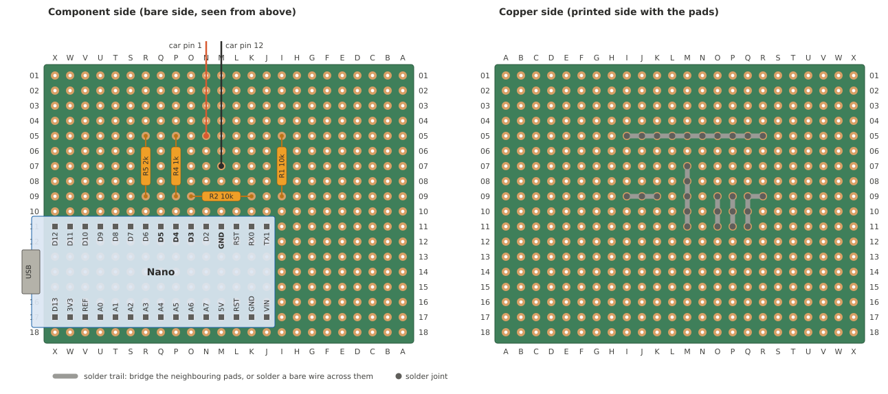

# Nano adapter (E935)

A soldered version of the [inverted wiring](../docs/wiring.md#inverted-wiring-e935).
It uses the same circuit and the same firmware. The Arduino Nano replaces the Uno,
and a perfboard replaces the breadboard. One 2k resistor replaces R5 and R6 in series.

The bridge firmware keeps the E935 allowlist and the misread lock. A plain
USB-serial cable has neither, so the E935 needs this microcontroller adapter.

A factory-made board of the same circuit is in [kicad/](kicad/README.md).

`nano-adapter.py` draws the SVG. Before it draws, it checks the layout against
the circuit. Run `python3 hardware/nano-adapter.py > hardware/nano-adapter.svg`
after every change.

## Parts

| Part | Note |
|---|---|
| Arduino Nano or clone, ATmega328P, 16 MHz | With pin headers |
| Perfboard PY 5 cm × 7 cm, 18 columns (01–18) × 24 rows (A–X), 0.1" pitch | Every pad is isolated. |
| R1, R2: 10k | 1/4 W, laid flat with 0.4" lead spacing |
| R4: 1k | The same |
| R5: 2k | The same |
| Bare tinned wire, or the cut resistor legs | For the long solder trails |
| Two-core cable | To the 12-pin plug |
| 12-pin mating plug | See [the roadmap](README.md#open-questions) |

## Build

1. Hold the board with the component side up, row A at the top and column 01 at the left.
2. Find the Nano header with D2–D12. Its pins go in column 08, rows A–O. The USB socket points past row A.
3. Compare the Nano labels with the drawing. D5, D4, D3 and GND must be in holes H08, I08, J08 and L08.
4. Solder the Nano.
5. Put in the resistors and the two car wires as the component-side view shows. Solder their legs.
6. Turn the board over. Make every solder trail of the copper-side view.
7. For a trail of two or three pads, bridge the neighbouring pads with solder.
8. For the longer trails in column 14 and row L, lay a bare wire across the pads. Solder it at every pad.
9. Check the trails in rows H, I and J next to the Nano. They are close, and must not touch each other.
10. Wire the plug: the pin 1 wire to pin 1, the pin 12 wire to pin 12.
11. Bridge pin 10 to pin 12 inside the plug.
12. Fix the cable to the board with a cable tie through free holes, for example in rows R–T.

## Check before the car

Keep the Nano unpowered and the plug free. Measure in ohms:

| From | To | Expected |
|---|---|---|
| Plug pin 1 | Nano D4 | 1k |
| Plug pin 1 | Nano D5 | 2k |
| Plug pin 1 | Nano D3 | 20k |
| Plug pin 1 | Plug pin 12 | Not 0 Ω |
| Plug pin 12 | Nano GND | 0 Ω |
| Plug pin 10 | Plug pin 12 | 0 Ω |

The Nano input protection can change the readings to pin 1 a little.
A reading near 0 Ω is a solder bridge.

Also measure between neighbouring Nano pins D5–D4, D4–D3 and D3–D2. None may read 0 Ω.

## Firmware and use

Upload `firmware/dsm_bridge/dsm_bridge.ino` with `#define WIRING_INVERTED`.
Some Nano clones need the board option "ATmega328P (Old Bootloader)".

Then use the [bench test](../docs/wiring.md#bench-test-without-the-car) and the
[rules](../docs/wiring.md#inverted-wiring-e935) of the inverted wiring.
They apply to this adapter without change.
